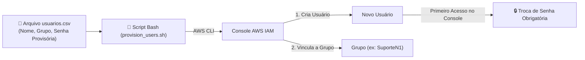

# AWS Lab: Provisionamento em Massa de Usuários no IAM com Shell Script

Prática realizada durante a formação **AWS re/Start (Escola da Nuvem)** para resolver o desafio de cadastrar dezenas de novos colaboradores na nuvem de forma ágil, padronizada e segura.

A estrutura de grupos e políticas foi criada pelo **Console da AWS**, e o cadastro em lote foi realizado via terminal (**AWS CloudShell** ou Linux) utilizando um script em **Bash** simples com a **AWS CLI**.

---

## 🏛️ Cenário e Boas Práticas

Criar usuários um a um manualmente pelo console é demorado e propenso a erros. Este lab automatiza a leitura de uma planilha CSV com a lista de novos funcionários e executa três boas práticas fundamentais de segurança:

1. **Menor Privilégio:** Os usuários não recebem permissões diretas. Eles são vinculados a **Grupos de Usuários** predefinidos (ex: `SuporteN1`, `DBA`, `Estagiarios`).
2. **Senha Temporária com Reset Obrigatório:** O parâmetro `--password-reset-required` força o colaborador a cadastrar uma nova senha pessoal logo no primeiro login.
3. **MFA (Autenticação Multi-Fator):** Política que exige ativação do MFA para acesso aos recursos.



---

## 🛠️ Passo a Passo da Configuração

### 1. Criar os Grupos de Usuários no Console (Console IAM)
Antes de rodar o script, crie no console os grupos para os setores da empresa e anexe as políticas correspondentes:
1. Acesse **IAM** > **Grupos de usuários** > **Criar grupo**.
   - Grupo: `SuporteN1` -> anexar política de leitura (ex: `ReadOnlyAccess`).
   - Grupo: `DBA` -> anexar política de banco de dados (ex: `AmazonRDSFullAccess`).
   - Grupo: `Estagiarios` -> anexar política restrita para aprendizado.

---

### 2. Preparar o Arquivo CSV
Crie o arquivo `usuarios.csv` com a lista de colaboradores (conforme o modelo `usuarios.csv.example`):

```text
usuario,grupo,senha_temporaria
ana.souza,SuporteN1,Mudar@2026!
carlos.lima,DBA,Mudar@2026!
mariana.silva,Estagiarios,Mudar@2026!
```

---

### 3. Executar o Script no Terminal (AWS CloudShell ou Linux)
Abra o **AWS CloudShell** diretamente pelo topo do Console da AWS (ou seu terminal configurado com AWS CLI):

```bash
# 1. Dar permissão de execução ao script
chmod +x provision_users.sh

# 2. Executar a criação em lote
./provision_users.sh
```

Saída no terminal:
```text
Iniciando provisionamento de usuarios no AWS IAM...
----------------------------------------------------
>> Processando usuario: ana.souza (Grupo: SuporteN1)
   [OK] Usuario ana.souza criado e vinculado ao grupo SuporteN1.
>> Processando usuario: carlos.lima (Grupo: DBA)
   [OK] Usuario carlos.lima criado e vinculado ao grupo DBA.
>> Processando usuario: mariana.silva (Grupo: Estagiarios)
   [OK] Usuario mariana.silva criado e vinculado ao grupo Estagiarios.
----------------------------------------------------
Todos os usuarios foram provisionados com sucesso!
```

---

## 🧪 Validação do Primeiro Acesso

1. Copie o link de login do console da sua conta AWS (`https://<SUA-CONTA>.signin.aws.amazon.com/console`).
2. Tente fazer login como `ana.souza` com a senha provisória `Mudar@2026!`.
3. O console da AWS imediatamente bloqueará o acesso direto e exigirá que a colaboradora digite uma nova senha pessoal antes de liberar a visualização dos recursos.

---

## 🧹 Script de Limpeza (Teardown)
Para remover os usuários de teste criados após o laboratório:
```bash
chmod +x teardown_users.sh
./teardown_users.sh
```
