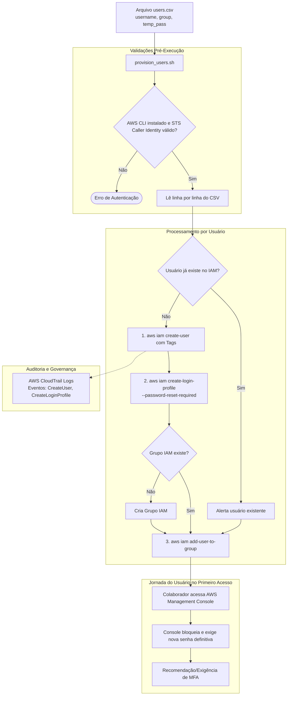

# 🔐 AWS Lab: Automação de Provisionamento IAM em Massa com Shell Script

[-FF9900?logo=amazon-aws&logoColor=white)](https://aws.amazon.com/iam/)
[](https://www.gnu.org/software/bash/)
[](https://www.cisecurity.org/)
[](https://aws.amazon.com/cli/)
[](LICENSE)

Este repositório apresenta uma solução de engenharia e automação em **Shell Script (Bash)** integrada ao **AWS CLI v2** para provisionamento corporativo em massa de usuários no **AWS Identity and Access Management (IAM)** a partir de arquivos CSV. O projeto adota o princípio de menor privilégio (*Least Privilege*), governança com tags, criação automatizada de grupos e obrigatoriedade de troca de senha no primeiro acesso (`--password-reset-required`).

---

## 📑 Sumário

- [Visão Geral & Diagrama de Arquitetura](#-visão-geral--diagrama-de-arquitetura)
- [Estrutura do Repositório](#-estrutura-do-repositório)
- [Boas Práticas de Segurança e CIS Benchmark](#-boas-práticas-de-segurança-e-cis-benchmark)
- [Estrutura do Arquivo CSV](#-estrutura-do-arquivo-csv)
- [Passo a Passo de Execução](#-passo-a-passo-de-execução)
  - [1. Configuração de Credenciais](#1-configuração-de-credenciais)
  - [2. Simulação com Modo Dry-Run](#2-simulação-com-modo-dry-run)
  - [3. Provisionamento em Massa](#3-provisionamento-em-massa)
  - [4. Auditoria via AWS CloudTrail](#4-auditoria-via-aws-cloudtrail)
- [Política de Menor Privilégio](#-política-de-menor-privilégio)
- [Teardown & Remoção em Massa](#-teardown--remoção-em-massa)
- [Estimativa de Custos](#-estimativa-de-custos)

---

## 🏗 Visão Geral & Diagrama de Arquitetura

O processo automatiza a leitura de um arquivo CSV de novos colaboradores, valida o formato dos dados, garante a existência dos grupos departamentais, cria os usuários com tags de rastreabilidade e configura o perfil de login no console exigindo redefinição imediata de credenciais:



---

## 📂 Estrutura do Repositório

```text
aws-lab-iam-automation-bash/
├── README.md                      # Documentação detalhada e instruções
├── .gitignore                     # Protege contra versionamento acidental de arquivos CSV reais
├── users.csv.example              # Modelo de layout do arquivo de entrada
├── provision_users.sh             # Script de provisionamento em massa com validações
├── teardown_users.sh              # Script de limpeza reversa de usuários do laboratório
└── policies/
    └── standard-user-policy.json  # Política de autoatendimento (troca de senha e MFA)
```

---

## 🛡 Boas Práticas de Segurança e CIS Benchmark

Esta automação foi desenhada em estrita aderência aos requisitos de identidade do **CIS AWS Foundations Benchmark**:

1. **Troca Obrigatória de Senha no 1º Acesso:** Nenhum administrador conhece a senha final do usuário; a senha temporária é invalidada no primeiro logon via `--password-reset-required`.
2. **Acesso Baseado em Grupos (RBAC):** Usuários nunca recebem políticas gerenciadas diretamente (inline policies no usuário são anti-pattern). As permissões derivam estritamente do grupo funcional (`SupportUsers`, `DevOpsEngineers`, `DatabaseAdmins`).
3. **Tags de Rastreabilidade e Auditoria:** Todo usuário recebe tags obrigatórias:
   - `CreatedBy: IAM-Automation`
   - `Environment: Lab`
   - `ProvisionDate: YYYY-MM-DD`
4. **Política de Autoatendimento:** Permite ao usuário redefinir a própria senha e configurar dispositivos Virtuais de MFA (Google Authenticator / Authy / 1Password) sem necessitar de privilégios administrativos.

---

## 📄 Estrutura do Arquivo CSV

O arquivo de entrada deve conter 3 colunas separadas por vírgula:

```csv
username,group,temporary_password
carlos.silva,SupportUsers,TempPass@2026!Sec1
mariana.souza,DevOpsEngineers,CloudDev#2026!A1
rafael.lima,DatabaseAdmins,DbAdmin$2026!K9
```

> ⚠️ **Atenção:** O arquivo `users.csv` real é ignorado automaticamente pelo `.gitignore` para prevenir o vazamento acidental de credenciais temporárias no controle de versão.

---

## 🚀 Passo a Passo de Execução

### 1. Configuração de Credenciais

Garanta que sua sessão local possua permissões administrativas de IAM (`IAMFullAccess` ou role equivalente):

```bash
aws sts get-caller-identity
```

### 2. Simulação com Modo Dry-Run

Antes de aplicar qualquer alteração na conta AWS, execute o modo de simulação para validar a sintaxe e as linhas do arquivo:

```bash
chmod +x *.sh

./provision_users.sh --csv users.csv.example --dry-run
```

### 3. Provisionamento em Massa

Execute o script apontando para o arquivo desejado:

```bash
./provision_users.sh --csv users.csv.example
```

**Exemplo de saída de execução:**
```text
[INFO] 2026-11-06 18:45:10 Validando credenciais da AWS...
[SUCCESS] 2026-11-06 18:45:11 Autenticado na Conta AWS: 123456789012 (arn:aws:iam::123456789012:user/admin)
[INFO] 2026-11-06 18:45:11 Iniciando processamento do arquivo: users.csv.example
------------------------------------------------------------
[INFO] 2026-11-06 18:45:11 Processando usuário #1: [carlos.silva] | Grupo: [SupportUsers]
[INFO] 2026-11-06 18:45:11 Criando grupo IAM 'SupportUsers'...
[SUCCESS] 2026-11-06 18:45:12 Grupo 'SupportUsers' criado com sucesso.
[INFO] 2026-11-06 18:45:12 Criando usuário IAM 'carlos.silva' com tags de governança...
[SUCCESS] 2026-11-06 18:45:13 Usuário 'carlos.silva' criado com sucesso.
[INFO] 2026-11-06 18:45:13 Configurando login web com flag --password-reset-required...
[SUCCESS] 2026-11-06 18:45:13 Perfil de acesso criado: Troca obrigatória no primeiro login ativada.
[INFO] 2026-11-06 18:45:13 Associando usuário 'carlos.silva' ao grupo 'SupportUsers'...
[SUCCESS] 2026-11-06 18:45:14 Usuário 'carlos.silva' adicionado ao grupo 'SupportUsers'.
============================================================
[INFO] 2026-11-06 18:45:20 Resumo do Provisionamento IAM:
  Total processados : 5
  Criados com êxito : 5
  Já existentes     : 0
  Erros/Falhas      : 0
============================================================
[SUCCESS] 2026-11-06 18:45:20 Provisionamento concluído com êxito total!
```

---

### 4. Auditoria via AWS CloudTrail

Você pode validar os eventos de auditoria gerados pela automação através do CloudTrail:

```bash
aws cloudtrail lookup-events \
  --lookup-attributes AttributeKey=EventName,AttributeValue=CreateUser \
  --max-results 5 \
  --query "Events[*].{EventTime:EventTime,Username:Username,EventName:EventName}" \
  --output table
```

---

## 🔒 Política de Menor Privilégio

O arquivo [`policies/standard-user-policy.json`](policies/standard-user-policy.json) pode ser anexado aos grupos criados para habilitar permissões essenciais de suporte e autosserviço:

```bash
# 1. Criação da política na AWS
POLICY_ARN=$(aws iam create-policy \
  --policy-name "StandardUserSelfServicePolicy" \
  --policy-document file://policies/standard-user-policy.json \
  --query "Policy.Arn" \
  --output text)

# 2. Vinculação ao grupo SupportUsers
aws iam attach-group-policy \
  --group-name "SupportUsers" \
  --policy-arn "$POLICY_ARN"
```

---

## 🧹 Teardown & Remoção em Massa

Para limpar rapidamente todos os usuários criados no laboratório de forma idempotente:

```bash
./teardown_users.sh --csv users.csv.example --delete-groups
```

O script de teardown:
1. Desvincula o usuário de todos os grupos IAM.
2. Remove o perfil de login de console (`aws iam delete-login-profile`).
3. Deleta access keys associadas, caso existam.
4. Exclui o usuário do IAM.
5. Opcionalmente remove os grupos criados.

---

## 💰 Estimativa de Custos

| Serviço | Especificação | Custo |
| :--- | :--- | :--- |
| **AWS Identity and Access Management (IAM)** | Usuários, Grupos, Perfis de Acesso e Políticas | **\$0.00 (Serviço gratuito sem cobrança)** |
| **AWS CloudTrail** | Trilha padrão de eventos de gerenciamento (*Management Events*) | **\$0.00 (Incluso no AWS Free Tier)** |
| **Total Estimado** | Laboratório de Onboarding de Identidades | **\$0.00 / mês** |

---

## 👨‍💻 Autor

Desenvolvido por **Cesar Lana**  
GitHub: [@CesarLana](https://github.com/CesarLana)
